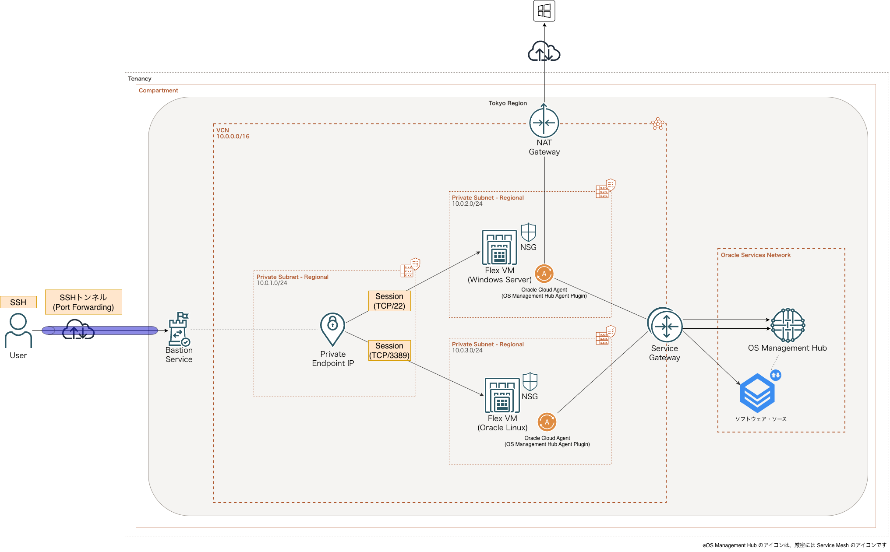

# OCI OS管理ハブ

OCI OS管理ハブの構成およびTerraformによる構築・管理に関する情報をまとめる。

- 技術解説：[OCI OS管理ハブについて整理する（Qiita）]()

## 構成図

## 作業環境

| ツール             | バージョン                    |
| ------------------ | ----------------------------- |
| OS                 | macOS Tahoe v26.6.2           |
| Visual Studio Code | 1.142.0                       |
| OCI CLI            | 3.x                           |
| Python             | 3.14.8                        |
| Terraform          | `.terraform-version` のとおり |
| TFLint             | 任意（`.tflint.hcl` あり）    |

## フォルダ構成

ディレクトリ構成および各ファイルの役割については、[フォルダ構成](./docs/folder.md) を参照する。

## コーディング規約

Terraformコードの作成・変更・レビューにあたっては、HashiCorp公式のベストプラクティスを基本とした共通コーディング規約に従う。

ディレクトリ・モジュール構成、命名規則、変数・Backend設定、リソース定義、品質管理などの詳細は、[Terraformコーディング規約](./docs/terraform-coding-standards.md) を参照する。

## 実行手順

TerraformによるOCI環境の構築・変更に関する手順を定める。

前提条件、OCI認証、State管理用バケットの準備、入力変数・Backend設定、静的解析・テスト、`plan`・`apply` の詳細は、[Terraform実行手順](./docs/deployment.md) を参照する。

## 環境削除

検証環境などの削除に関しては、破壊的な操作とTerraform Stateの管理を伴うため、通常の実行手順とは分けて管理する。

- [環境削除手順](./docs/cleanup.md)
- [トラブルシューティング](./docs/troubleshooting.md)

> [!CAUTION]
> 本番環境で環境削除手順を実行しないこと。対象リソースとStateを必ず確認する。
