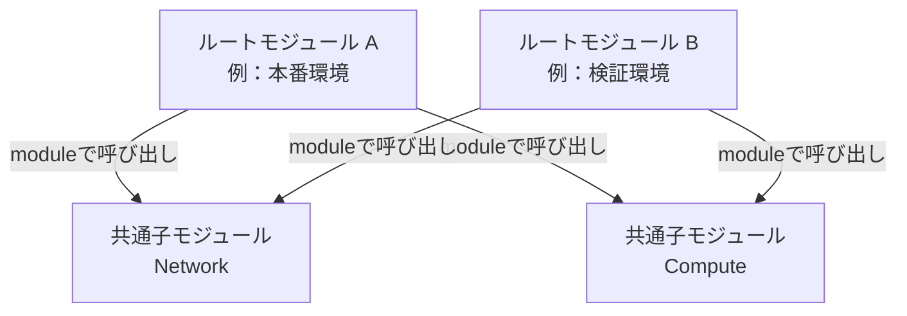

# Terraform コーディング規約

> 適用対象：Terraformのルートモジュールおよび子モジュール／クラウドプロバイダー非依存  
> 位置づけ：人間と生成AIが共通して参照するコーディング基準

## 1. 目的と適用方針

本規約は、TerraformによるInfrastructure as Code（IaC）の**可読性・保守性・再利用性・安全性・再現性**を確保することを目的とする。

**HashiCorp公式のTerraform Style GuideおよびStandard Module Structureに示されるベストプラクティスを基本とし、実務上の保守性・運用性を考慮して策定する。**

特定のクラウドプロバイダー、ディレクトリ構成、プロジェクトに依存しない汎用的なコーディング規約とし、人間および生成AIによるTerraformコードの作成・変更・レビューに共通して適用する。

- HashiCorp公式の推奨事項を基本とし、独自の運用ルールと区別する。
- ルートモジュールがプロジェクト直下にある構成、任意のサブディレクトリにある構成、環境別に分割された構成をいずれも認める。
- 子モジュールの利用は必須とせず、責務・再利用・保守性に応じて判断する。
- AWS、OCI、Azureなどのプロバイダー固有ルール、パラメータシートとの対応、命名接頭辞などは別途プロジェクト規約に定める。
- **既存プロジェクトは既存の構成と運用との整合を優先**し、合理的な理由なく再配置・改名しない。

| 区分 | 意味                                                                |
| ---- | ------------------------------------------------------------------- |
| 必須 | Terraformの技術的制約、セキュリティ上の要請、または本規約の遵守事項 |
| 原則 | 標準的な方法。合理的な理由がある場合は例外を認める                  |
| 推奨 | プロジェクトの規模や運用に応じて適用することが望ましい              |

「公式推奨」と「本規約における運用上の取り決め」は同一ではない。実際のプロジェクトに固有の決定事項は別文書に記す。

## 2. モジュールとディレクトリ構成

### 2.1 用語

| 用語             | 定義                                                                                    |
| ---------------- | --------------------------------------------------------------------------------------- |
| モジュール       | 同じディレクトリにあるTerraform構成ファイル群。`.tf` ファイルごとにスコープは分かれない |
| ルートモジュール | `terraform plan` / `apply` の実行対象となるモジュール                                   |
| 親モジュール     | `module` ブロックで別のモジュールを呼び出す側                                           |
| 子モジュール     | `module` ブロックから呼び出される側                                                     |

「親」「子」は呼び出し関係を表す相対的な呼び名であり、ディレクトリの上下関係を表すものではない。`envs/`、`environments/`、`prd/`、`stg/` などのディレクトリ名はTerraformの必須要素ではない。

### 2.2 モジュール関係図（構成例）



この図は**子モジュールを利用する場合の一例**。子モジュールを使わない場合は、ルートモジュール内に `resource` や `data` を直接定義する。AとBが同じ子モジュールのソースコードを参照しても、適切にStateを分ければ各環境のリソースは独立して管理される。

### 2.3 許容する配置例

#### 単一ルートモジュール（フラット構成）

```text
project/
├── main.tf
├── terraform.tf
├── providers.tf
├── variables.tf
├── outputs.tf
└── terraform.tfvars
```

#### 環境別ルートモジュール（子モジュールなし）

```text
project/
├── prd/                 # ルートモジュール
│   ├── main.tf
│   └── variables.tf
└── stg/                 # 独立したルートモジュール
    ├── main.tf
    └── variables.tf
```

#### 環境別ルートモジュール＋共通子モジュール

```text
project/
├── environments/        # 任意の整理用ディレクトリ
│   ├── prd/             # ルートモジュール
│   │   ├── main.tf
│   │   ├── backend.tf
│   │   ├── providers.tf
│   │   └── terraform.tfvars
│   └── stg/             # ルートモジュール
│       ├── main.tf
│       ├── backend.tf
│       └── terraform.tfvars
├── modules/
│   ├── network/         # 子モジュール
│   │   ├── main.tf
│   │   ├── variables.tf
│   │   └── outputs.tf
│   └── compute/         # 子モジュール
│       ├── main.tf
│       ├── variables.tf
│       └── outputs.tf
└── coding-standards.md
```

※ 省略したファイルが不要という意味ではない。必要な設定や入力・出力に応じて追加する。

### 2.4 構成ルール

| 区分 | 項目               | ルール                                                                       |
| ---- | ------------------ | ---------------------------------------------------------------------------- |
| 必須 | 実行単位           | どのディレクトリがルートモジュールか明確にする                               |
| 原則 | 配置場所           | ルートモジュールの配置場所・ディレクトリ名を固定しない                       |
| 原則 | モジュール分割     | 明確な責務、再利用、独立した変更単位がある場合に検討し、機械的に細分化しない |
| 推奨 | ローカルモジュール | 同一リポジトリの再利用コードは `modules/<name>/` などに整理する              |
| 原則 | ネスト             | 不必要な多段階のモジュール呼び出しを避ける                                   |
| 原則 | 環境分割           | 独立した環境は必要に応じて別々のルートモジュールに分ける                     |
| 必須 | State              | 同一の管理対象を複数のStateで重複管理しない。独立環境ではStateを分離する     |

## 3. Terraformファイルの命名と配置

| ファイル名      | 主な内容                                 | 扱い                                    |
| --------------- | ---------------------------------------- | --------------------------------------- |
| `terraform.tf`  | `required_version`、`required_providers` | 原則                                    |
| `providers.tf`  | `provider` の設定                        | ルートモジュールで原則使用              |
| `backend.tf`    | Backendの種類・設定                      | Backendを明示するルートモジュールで使用 |
| `main.tf`       | 主な `resource`、`data`、`module`        | 原則                                    |
| `variables.tf`  | 入力変数の宣言                           | 原則                                    |
| `outputs.tf`    | 出力値の宣言                             | 原則                                    |
| `locals.tf`     | 複数ファイルで共有するローカル値         | 必要に応じて                            |
| `data.tf`       | 複数の機能で共用するdataソース           | 必要に応じて                            |
| `network.tf` 等 | 論理的な責務ごとの定義                   | 規模が大きい場合                        |
| `README.md`     | 構成・利用方法・実行方法                 | 推奨                                    |

- 小規模な構成は `main.tf` にまとめてよい。
- 大きな構成は `network.tf`、`compute.tf`、`storage.tf` など、**論理的なまとまり**で分割する。
- ファイル名には小文字の `snake_case` を基本として使用する。ただし上表の慣習的な標準名はそのまま使用する。
- 同一モジュール内で `variable`、`locals`、`resource`、`data` などの名称が競合しないようにする。
- `override.tf` と `*_override.tf` は意図が追いにくくなるため原則使わない。
- `.tf` ファイルの記述順・ファイル名のアルファベット順によってリソース作成順序を制御しない。

## 4. 識別子・命名規則

| 区分 | 項目            | ルール                                                                |
| ---- | --------------- | --------------------------------------------------------------------- |
| 原則 | Terraform識別子 | 意味のある名詞と `snake_case` を使用する                              |
| 原則 | `resource` 名   | 役割を表す名前とし、resourceタイプの重複を避ける                      |
| 原則 | `data` 名       | 取得対象・用途がわかる名前にする                                      |
| 原則 | `variable` 名   | 入力の意味を明確にする                                                |
| 原則 | `locals` 名     | 計算結果・用途がわかる名前にする                                      |
| 原則 | `output` 名     | 公開する値がわかる名前にする。必要に応じて `_id`、`_ids` などを用いる |
| 原則 | `module` 名     | 子モジュールの役割がわかる名前にする                                  |
| 任意 | `this`          | モジュールの主たる対象が一意に理解できる場合だけ使用してよい          |
| 必須 | `for_each` キー | 安定した一意のキーを使う。クラウド上の表示名との一致は必須としない    |

例：`resource "aws_security_group" "web"`、`local.subnet_ids`、`output "vpc_id"`。

## 5. 入力変数の宣言（`variables.tf`）

| 区分 | 項目       | ルール                                                             |
| ---- | ---------- | ------------------------------------------------------------------ |
| 必須 | 型         | すべての入力変数に `type` を指定する                               |
| 必須 | 説明       | すべての入力変数に `description` を記載する                        |
| 原則 | デフォルト | 省略可能で合理的な共通値がある場合に `default` を指定する          |
| 推奨 | 検証       | 明確な形式・範囲制約には `validation` を使用する                   |
| 原則 | 変数の粒度 | 呼び出し元や環境で変更する値を公開し、全属性を機械的に変数化しない |
| 原則 | 複合値     | 関連する設定は `object`、`map(object(...))` 等で適切に構造化する   |
| 必須 | 機密値     | 必要に応じて `sensitive = true` を指定し、平文の記述を避ける       |
| 原則 | 並び順     | `variables.tf` の変数は名称順など一貫した順序で整理する            |

```hcl
variable "subnets" {
  type = map(object({
    cidr_block = string
    public     = optional(bool, false)
  }))
  description = "Subnets indexed by stable logical key"
}
```

## 6. 入力変数の値（tfvars・環境変数）

### 6.1 ルール

| 区分 | 項目             | ルール                                                                                                     |
| ---- | ---------------- | ---------------------------------------------------------------------------------------------------------- |
| 原則 | ローカルCLI      | 通常の非機密値にはルートモジュールの `terraform.tfvars` を標準候補とする                                   |
| 任意 | 明示的な切り替え | 任意の `*.tfvars` を `-var-file` で読み込んでよい                                                          |
| 任意 | 自動読込         | `terraform.tfvars`、`terraform.tfvars.json`、`*.auto.tfvars`、`*.auto.tfvars.json` を使用してよい          |
| 原則 | 配置             | 自動読み込みを使う場合は、対象ルートモジュールのディレクトリに配置する                                     |
| 原則 | 複数環境         | ルートモジュールごとに設定値を分離する。単一ルートで切り替える場合はStateも明示的に分離する                |
| 必須 | 子モジュール     | 子モジュールの入力値は呼び出し元の `module` 引数から渡す。子モジュール配下のtfvarsの自動読込には依存しない |
| 推奨 | CI/CD            | 実行基盤の変数管理機能、`TF_VAR_*`、`-var-file` など適切な方法を採用する                                   |
| 必須 | 機密情報         | 機密値をGit管理対象のtfvarsに含めない。Secret管理機能や適切な認証方式を使用する                            |
| 原則 | 競合回避         | 同一変数を複数の場所で重複して指定する運用を避ける                                                         |

`terraform.tfvars` の例：

```hcl
subnets = {
  private = {
    cidr_block = "10.0.1.0/24"
    public     = false
  }
}
```

明示的に切り替える例：

```bash
terraform plan -var-file="config/prd.tfvars"
```

Terraform CLIの入力値の優先順位（高い順）は、おおむね **`-var` / `-var-file`（指定順）→ `*.auto.tfvars`（辞書順）→ `terraform.tfvars.json` → `terraform.tfvars` → `TF_VAR_*` → `default`**。HCP Terraformではワークスペース側の変数管理の仕様も確認する。優先順位に依存した意図しない上書きを避ける。

## 7. ローカル値（`locals`）と出力値（`output`）

| 区分 | 項目            | ルール                                                                                           |
| ---- | --------------- | ------------------------------------------------------------------------------------------------ |
| 原則 | `locals` の用途 | 共通値、入力の正規化、導出値に限定し、不要な中間変数を増やさない                                 |
| 原則 | `locals` の配置 | 複数ファイルから参照する場合は `locals.tf`、単一ファイルで完結する場合は当該ファイルの先頭に置く |
| 原則 | `output` の配置 | `outputs.tf` にまとめる                                                                          |
| 必須 | `output` の説明 | `description` を記載する                                                                         |
| 原則 | `output` の範囲 | 呼び出し元・外部利用者が必要とする値のみ公開する                                                 |
| 必須 | 機密output      | 機密値を出力する場合は `sensitive = true` を設定し、利用先も保護する                             |

## 8. `resource`・`data`・参照方法

### 8.1 参照方法

| 参照対象                                        | 原則の方法                                                                                  |
| ----------------------------------------------- | ------------------------------------------------------------------------------------------- |
| 同一モジュールで作成するリソース                | `resource` の属性を直接参照する                                                             |
| 子モジュールで作成するリソース                  | 子の `output` を呼び出し元で参照し、必要なモジュールへ入力として渡す                        |
| Terraform管理外の既存リソース・プロバイダー情報 | 必要に応じて `data` で取得する                                                              |
| 外部からIDが渡されるリソース                    | 入力変数で受け取る                                                                          |
| 別Stateで管理するリソース                       | 安定したインターフェース（入力変数、provider固有のdata等）を使い、State間の強い結合を避ける |

### 8.2 `data` の定義

| 区分 | 項目           | ルール                                                                       |
| ---- | -------------- | ---------------------------------------------------------------------------- |
| 原則 | 配置           | dataを使用するresource・module定義の近くに配置し、可能なら参照元より前に書く |
| 任意 | `data.tf`      | 共通して使用するdataや一覧性が向上する場合は集約してよい                     |
| 任意 | 機能別ファイル | 規模が大きい場合は `network_data.tf` などに分割してよい                      |
| 原則 | 選択条件       | 意図した対象を一意に特定できる条件を使う                                     |
| 原則 | 不要な再取得   | 同一モジュールで作成したresourceのIDをdataで再取得しない                     |
| 原則 | 子モジュール   | 外部環境への暗黙的な依存を避け、識別子などは必要に応じて入力で受け取る       |

**`data.tf` の作成は必須ではない。** `data` は通常の `.tf` ファイルに定義でき、ファイル名で参照スコープは変わらない。

### 8.3 繰り返しと依存関係

- `for_each` は安定したキーを持つ複数インスタンスに適用する。表示名変更に連動してTerraformアドレスが変わらない設計を優先する。
- `count` はインデックス管理が自然な場合や、単純な作成有無の切り替えなどに使用する。
- `depends_on` はTerraformが参照から推論できない依存があるときだけ使用する。
- `dynamic`、複雑な内包表記、ネストした条件式は可読性と保守性を優先して使用する。
- 定義の記述順でリソースの作成順序を制御しない。

### 8.4 パラメータの網羅性

`resource`・`data` の定義にあたっては、使用するProviderのバージョンに対応した公式仕様を確認し、設定可能なパラメータを網羅的に把握したうえで、設定要否を判断する。

| 区分 | 項目               | ルール                                                                                                           |
| ---- | ------------------ | ---------------------------------------------------------------------------------------------------------------- |
| 必須 | 設定項目の網羅     | 使用するProviderのバージョンに対応した公式仕様を確認し、設定可能な引数・ネストブロックを網羅的に把握する。       |
| 必須 | 必須パラメータ     | 必須の設定項目を漏れなく定義する。                                                                               |
| 原則 | 任意パラメータ     | 任意の設定項目についても設定要否を判断し、必要なものは明示的に定義する。                                         |
| 原則 | 省略するパラメータ | 省略時のデフォルト動作や影響を確認し、設計要件との整合性を判断する。                                             |
| 原則 | 読み取り専用属性   | Providerが自動設定するComputed属性など、設定できない項目は定義対象に含めない。                                   |
| 必須 | 設定の整合性       | 排他的なパラメータ、条件付きの必須項目、リソースの置換を伴う設定など、Provider固有の制約を確認する。             |
| 原則 | 設定値の明示       | セキュリティ、可用性、性能、運用などに影響する重要な設定は、デフォルト値への依存を避け、明示的な定義を検討する。 |

**設定可能なパラメータを網羅的に確認することと、すべてのパラメータをTerraformコードに明示することは区別する。**

設定要否の判断結果は、必要に応じて設計書やパラメータシートなどに記録する。Terraformコードには実際に必要な設定を定義し、不要なパラメータの記述や過度な複雑化を避ける。

## 9. 子モジュールの設計と再利用

| 区分 | 項目               | ルール                                                                               |
| ---- | ------------------ | ------------------------------------------------------------------------------------ |
| 原則 | 責務               | 論理的に関連し、一緒に管理すべきリソース群をまとめる                                 |
| 原則 | 依存               | 子モジュール間は可能な限り呼び出し元で結合する                                       |
| 必須 | 入出力             | 子モジュールの外部インターフェースは `variable` と `output` を使用する               |
| 必須 | provider           | 子モジュールには `provider` 設定ブロックを定義しない                                 |
| 必須 | provider要件       | 必要な `required_providers` を子モジュール自身に宣言する                             |
| 必須 | backend            | 子モジュールにBackend設定を持たせない                                                |
| 推奨 | 基本ファイル       | 再利用モジュールは `main.tf`、`variables.tf`、`outputs.tf`、`README.md` を基本とする |
| 推奨 | 使用例             | 複雑な再利用モジュールには `examples/` を用意する                                    |
| 原則 | ソース             | 同じリポジトリのローカルモジュールには相対パスを用いる                               |
| 原則 | リモートモジュール | 公開Registry等から利用する場合は適切にバージョン固定する                             |

`modules/network/outputs.tf`：

```hcl
output "vpc_id" {
  description = "ID of the VPC"
  value       = aws_vpc.this.id
}
```

呼び出し元のルートモジュール：

```hcl
module "network" {
  source = "../modules/network"
  # 必要な入力変数を渡す
}

module "compute" {
  source = "../modules/compute"
  vpc_id = module.network.vpc_id
}
```

※ `source` の相対パスは呼び出し元のディレクトリ構成に合わせる。上記は入出力関係の例であり、各モジュールのその他の必須引数は省略している。

## 10. Terraform・Provider・Moduleのバージョン

| 区分 | 項目             | ルール                                                                           |
| ---- | ---------------- | -------------------------------------------------------------------------------- |
| 必須 | Terraform        | ルートモジュールに `required_version` を宣言する                                 |
| 必須 | provider要件     | すべてのモジュールで利用するproviderの `source` と必要なバージョン制約を宣言する |
| 原則 | ルートprovider   | 上限を含む互換性制約などで意図しない更新を抑制する                               |
| 原則 | 再利用モジュール | 必要な最小バージョンを示し、過度に厳しい上限制約を避ける                         |
| 原則 | 外部module       | バージョン・タグ・コミットなど再現可能な参照を選択する                           |
| 必須 | Lockファイル     | ルートモジュールの `.terraform.lock.hcl` をGitで管理する                         |

`terraform.tf` はバージョン要件とproviderの宣言、`providers.tf` は具体的なprovider設定を扱うことを標準とする。

## 11. Providerの設定

| 区分 | 項目                     | ルール                                                                     |
| ---- | ------------------------ | -------------------------------------------------------------------------- |
| 必須 | 設定場所                 | `provider` ブロックはルートモジュールに定義する                            |
| 原則 | ファイル                 | `providers.tf` に集約する                                                  |
| 原則 | デフォルト               | 通常利用するproviderにはデフォルト設定を用意する                           |
| 原則 | alias                    | 複数リージョン・アカウント等で必要なときに意味のあるaliasを使用する        |
| 必須 | 子モジュールへの受け渡し | alias等の追加設定が必要な場合は `module` の `providers` 引数で明示的に渡す |
| 必須 | 子モジュールでalias参照  | 必要な `configuration_aliases` を `required_providers` に宣言する          |
| 必須 | 認証情報                 | コード内に秘密鍵・固定認証情報を埋め込まない                               |

子モジュールがデフォルトproviderを使うだけなら、通常は呼び出し元から継承できる。環境・リージョン依存の設定は原則としてルートモジュール側で選択する。

## 12. BackendとStateの設定

### 12.1 Backendの定義

| 区分 | 項目         | ルール                                                                           |
| ---- | ------------ | -------------------------------------------------------------------------------- |
| 原則 | 定義場所     | Backendを明示する場合はルートモジュールの `backend.tf` に置く                    |
| 任意 | 完全設定     | 固定の非機密設定値を `backend.tf` に記述してよい                                 |
| 任意 | 部分設定     | 値を外部化する場合は `backend "..." {}` と `*.tfbackend` を組み合わせる          |
| 原則 | 外部ファイル | `<用途>.<backend名>.tfbackend`（例：`prd.s3.tfbackend`）を使用する               |
| 必須 | 外部値の読込 | `terraform init -backend-config=<path>` で指定する。自動読み込みはされない       |
| 必須 | 動的参照     | `backend` ブロックでは `var`、`local`、`data` 等を参照しない                     |
| 必須 | 機密情報     | 認証情報をBackendの構成ファイルや `-backend-config` の値として不用意に記述しない |
| 必須 | State保護    | 適切な認証・アクセス制御・暗号化・ロック・バックアップを検討する                 |
| 必須 | Backend変更  | 再初期化し、Stateの移行要否と実行対象を確認する                                  |

`backend.tf` の例：

```hcl
terraform {
  backend "s3" {}
}
```

`prd.s3.tfbackend` の例：

```hcl
bucket = "example-terraform-state"
key    = "prd/terraform.tfstate"
region = "ap-northeast-1"
```

読み込み例：

```bash
terraform init -backend-config="../backends/prd.s3.tfbackend"
```

このファイルはS3 Backendの例であり、OCIやその他のBackendでは必要なキーが異なる。Backend設定は初期化時に解決され、通常のTerraform入力変数とは別の仕組みである。

### 12.2 実行環境による選択

| 実行環境                             | 推奨する管理方式                                                             |
| ------------------------------------ | ---------------------------------------------------------------------------- |
| ローカルCLI                          | `terraform.tfvars` または `-var-file`、`backend.tf` または `-backend-config` |
| CI/CD                                | 変数ファイル・CI/CDの変数やSecret管理機能・実行時のBackend指定               |
| HCP Terraform / Terraform Enterprise | ワークスペースの変数・State管理機能、必要に応じて `cloud` ブロック           |

HCP Terraformの `cloud` ブロックと `backend` ブロックは同じTerraform構成内で併用しない。

### 12.3 Stateと環境の分離

- 独立してデプロイする環境は、原則としてStateも分離する。
- 同じ子モジュールを複数環境で共有しても、Stateの管理境界は各ルートモジュールまたは適切に設計したWorkspace単位で定義する。
- `-var-file` の変更だけではStateの参照先は変わらない。環境切り替え時にはStateの対応を確認する。
- Stateの分離方法はBackend・Workspace・実行環境の特性を踏まえて選択し、READMEなどに明記する。
- State間で値を共有する必要があるときは、出力値の公開範囲と依存関係を制御し、必要最小限の結合とする。

## 13. 記述スタイルとコメント

### 13.1 基本ルール

| 区分 | 項目               | ルール                                                                                                                                                         |
| ---- | ------------------ | -------------------------------------------------------------------------------------------------------------------------------------------------------------- |
| 必須 | フォーマット       | `terraform fmt` に準拠する。                                                                                                                                   |
| 必須 | インデント         | 半角スペース2文字を使用する。                                                                                                                                  |
| 原則 | 引用符             | HCLの文字列・ブロックラベルにダブルクォーテーションを使用する。                                                                                                |
| 原則 | コメント記法       | `#` を使用する。`//`、`/* */` は原則使用しない。                                                                                                               |
| 原則 | 見出しコメント     | `resource`・`data` の定義を論理的なまとまりごとに区切り、サービス名またはリソース種別を見出しとして記載する。見出しには # を使用し、区切り線で視認性を高める。 |
| 原則 | `resource` の説明  | 見出しコメントとは別に、各 resource ブロックの直前に、何を定義するか、何のために使用するかを記載する。設計上の制約・判断がある場合は併記する。                 |
| 原則 | `data` の説明      | 見出しコメントとは別に、各 data ブロックの直前に、取得する情報と取得目的を記載する。                                                                           |
| 原則 | パラメータの説明   | `resource`・`data` の各引数およびメタ引数の右側に、パラメータの役割と、本構成でどのように設定するかを簡潔に記載する。                                          |
| 原則 | 設計意図・注意事項 | セキュリティ、可用性、性能、運用などに関わる設計判断について、設定理由や制約を記載する。また、コードから読み取れない注意事項がある場合は併記する。             |
| 原則 | 動的な設定値       | `var`、`local`、`each.value` などを参照する場合は、値の取得元と設定方針を記載する。参照先によって変わる具体値をコメントに固定しない。                          |
| 原則 | ネストしたブロック | ブロックの用途を必要に応じて直前に説明し、内部の各引数にも同じ方針でコメントを付ける。                                                                         |
| 原則 | 長い説明           | 右側のコメントが長くなる場合や複数行の式では、該当項目の直前に説明を置いてよい。                                                                               |
| 必須 | コメントの整合性   | 設定変更時は関連するコメントを更新し、実際のコードや設定値と矛盾させない。                                                                                     |
| 原則 | 記述順             | `for_each`・`count`、通常の引数、ネストブロック、`lifecycle`、`depends_on` の順序を基本とする。                                                                |
| 原則 | 可読性             | パラメータの役割と今回の設定方針を過不足なく短く説明し、自明な処理への過剰なコメント、過剰な抽象化、同じ内容の不必要な繰り返しや複雑すぎる式を避ける。         |

コメントは、**ブロック直前で「何を定義するか・何のためか」**、**各パラメータの右側で「何を設定する項目か・今回はどう設定するか」**を伝えることを基本とする。属性名や設定値をそのまま言い換えるだけでなく、参照元や設計意図が伝わる表現にする。

なお、設定可能なパラメータの網羅性および設定要否の判断については、[8.4 パラメータの網羅性](#84-パラメータの網羅性) に従う。

### 13.2 記述例

```hcl
# ============================================================
# Subnet
# ============================================================

# 内部システム用のプライベートサブネットを定義する。
# パブリックIPの割当を禁止し、外部公開を抑止する。
resource "oci_core_subnet" "private" {
  compartment_id             = var.compartment_id   # 配置先コンパートメント。入力変数で指定した区画に作成する
  vcn_id                     = oci_core_vcn.this.id # 所属するVCN。同一モジュールで作成したVCNを使用する
  cidr_block                 = var.subnet_cidr      # IPアドレス範囲。環境ごとに渡されたCIDRを設定する
  display_name               = "private-subnet"     # OCIの表示名。内部向けサブネットと識別できる名称を設定する
  prohibit_public_ip_on_vnic = true                 # VNICへのパブリックIP割当。許可しない
}
```

見出しコメントにはサービス名またはリソース種別を記載し、複数の同種リソースをまとめて定義する場合は、見出しを共通化してよい。

※ この例はコメントの形式を説明するもので、特定プロジェクトの実際の設定値を指定するものではない。設定値の意味・適用可能な属性は利用するProviderの仕様で確認する。

Terraformでの依存関係は参照により判断されるため、宣言を前後に並べたこと自体が作成順序を保証するわけではない。

## 14. ライフサイクル・変更管理

| 区分 | 項目                    | ルール                                                                     |
| ---- | ----------------------- | -------------------------------------------------------------------------- |
| 原則 | `prevent_destroy`       | データ消失・復旧困難などの影響がある場合にプロジェクト方針に従って設定する |
| 原則 | `ignore_changes`        | 外部管理を認める属性に限定し、理由と影響を把握する                         |
| 原則 | `create_before_destroy` | 対象リソースの制約・依存関係・コストを確認して使用する                     |
| 原則 | `replace_triggered_by`  | 参照から推論できない置換要件がある場合に必要性を明示する                   |
| 必須 | アドレス変更            | resource名、`for_each` キー、モジュール移動時に `moved` などを検討する     |
| 必須 | 既存リソース導入        | import等を使用し、同一実体を重複管理しない                                 |
| 必須 | plan確認                | 作成・更新・削除・置換の意図を確認してからapplyする                        |

`prevent_destroy` は対象resourceブロック自体を構成から取り除いた場合には保護として機能しない。重要リソースではクラウド側の削除保護、権限制御、承認フロー等も併用する。

## 15. セキュリティと機密情報

- 認証情報、秘密鍵、パスワード、APIトークンを `.tf`、Git管理する `.tfvars`、Backend設定ファイルへ直接埋め込まない。
- ロール・Workload Identity・短期トークンなど、実行環境の安全な認証方式を優先する。
- `sensitive = true` はCLI表示等を抑制するものであり、Stateから値を除外・暗号化するものではない。
- State・保存plan・`.terraform/` に機密情報やBackend認証情報が含まれ得るため、保存先・権限・保持期間を制御する。
- 必要に応じてIaCセキュリティ検査や組織のPolicy as Codeを併用する。

## 16. Git管理と品質チェック

### 16.1 Git管理

| 区分 | 対象                                    | 方針                                      |
| ---- | --------------------------------------- | ----------------------------------------- |
| 必須 | `.tf`、必要な非機密設定ファイル、README | バージョン管理する                        |
| 必須 | `.terraform.lock.hcl`                   | ルートモジュールごとにGit管理する         |
| 必須 | State、`.terraform/`、plan、認証情報    | Git管理しない                             |
| 必須 | 機密を含むtfvars・Backend設定           | Git管理しない                             |
| 原則 | 非機密のtfvars・Backend設定             | チームの運用方針に合わせてGit管理してよい |
| 推奨 | `.gitignore`                            | 生成物・機密ファイルを除外する            |

`.gitignore` の例（保存planは `.tfplan` 拡張子で統一する場合）：

```gitignore
**/.terraform/
**/*.tfstate
**/*.tfstate.*
**/.terraform.tfstate.lock.info
**/*.tfplan
# 機密変数ファイルはプロジェクト規約に応じて追加
**/*.secrets.tfvars
```

※ 非機密の `terraform.tfvars` をGit管理するプロジェクトでは、すべての `*.tfvars` を無条件に除外しない。保存planに別の名前を使う場合も除外対象に加える。

### 16.2 検証

| 区分 | 検証                        | 目的                                       |
| ---- | --------------------------- | ------------------------------------------ |
| 必須 | `terraform fmt -check`      | フォーマットの統一                         |
| 必須 | `terraform validate`        | 構文・構成の整合性確認                     |
| 原則 | TFLint                      | Terraform・provider固有の静的解析          |
| 必須 | `terraform plan` のレビュー | 意図しない変更・置換・削除の防止           |
| 推奨 | Terraform test / 統合テスト | モジュールの振る舞いや実リソース動作の確認 |
| 推奨 | CI/CD                       | 検証・レビュー・承認プロセスの自動化       |

`fmt`、`validate`、TFLintに合格してもクラウド上での動作や設計の妥当性を保証するものではない。

### 16.3 実行例

以下は、**カレントディレクトリをルートモジュール**とするCLIの例。外部ファイルを使う場合は、それぞれの相対パスを実際の構成に合わせる。

```bash
# フォーマットと構成検証
terraform fmt -check
terraform init -backend=false
terraform validate

# TFLint（設定ファイルを明示する場合）
tflint --init --config="<path-to-.tflint.hcl>"
tflint --config="<path-to-.tflint.hcl>"
```

Backendを使用した通常のデプロイ例：

```bash
terraform init -backend-config="<path-to-config.s3.tfbackend>"
terraform plan -var-file="<path-to-environment.tfvars>"
# planを確認し、所定の承認後にapply
```

Backend設定が `backend.tf` 内で完結している場合やHCP Terraformを使用する場合は、それぞれの初期化方式に従う。上記コマンドは特定のディレクトリ名を要件としない。

## 17. プロジェクト固有規約との分担

本規約で固定しない事項は、必要に応じて `project-conventions.md` またはプロジェクトREADMEに記載する。

| 分野             | プロジェクトで定義する例                                 |
| ---------------- | -------------------------------------------------------- |
| ディレクトリ構成 | ルートモジュール配置、環境分割方法                       |
| 命名             | クラウドリソースの接頭辞、環境名、連番、タグ             |
| リソース設計     | モジュール分割単位、`for_each` のキーと表示名の対応      |
| 設計資料との対応 | パラメータシート・設計書と`.tf`ファイルの対応            |
| Provider         | クラウド、リージョン、アカウント、alias、認証方式        |
| 設定値           | `terraform.tfvars`、`-var-file`、CI/CD等の採用方式       |
| Backend          | Backend種別、`*.tfbackend` の配置、State保存先、環境分離 |
| 保護対象         | `prevent_destroy`、削除保護、承認方法                    |
| 実行手順         | init / plan / applyの実行ディレクトリと引数              |

既存コードに適用する場合は、変更によるStateアドレスの差分、providerの選択、Backendの移行などを事前に確認する。

## 18. 参考資料

- [HashiCorp Terraform Style Guide](https://developer.hashicorp.com/terraform/language/style)
- [HashiCorp Standard Module Structure](https://developer.hashicorp.com/terraform/language/modules/develop/structure)
- [Providers Within Modules](https://developer.hashicorp.com/terraform/language/modules/develop/providers)
- [Input Variables](https://developer.hashicorp.com/terraform/language/values/variables)
- [Backend Block Configuration](https://developer.hashicorp.com/terraform/language/backend)
- [Backend block configuration overview（partial configuration）- Terraform](https://developer.hashicorp.com/terraform/language/backend#partial-configuration)
- [Dependency Lock File](https://developer.hashicorp.com/terraform/language/files/dependency-lock)
- [Module Composition](https://developer.hashicorp.com/terraform/language/modules/develop/composition)
- [Tests - Terraform](https://developer.hashicorp.com/terraform/language/tests)
- [Mocks - Terraform](https://developer.hashicorp.com/terraform/language/tests/mocking)
