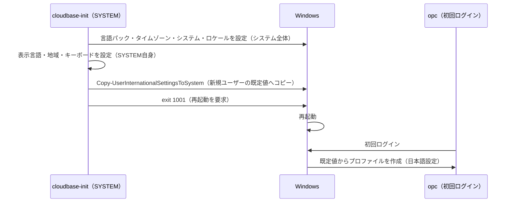

# Windows Serverのuser_dataによる日本語化

本書は、Windows Serverの初回起動時に **user_data（`envs/userdata/windows_init.ps1`）で表示言語・ロケール・キーボード・タイムゾーンを日本向けに設定する仕組み** と、その注意点をまとめる。

- [READMEへ戻る](../README.md)
- [Terraform実行手順](./deployment.md)
- [Oracle Linuxのuser_dataによる初期化](./linux-userdata.md)

> [!NOTE]
> 本書の内容のうち「未確認」と記した事項は、実機での動作確認が済んでいない。確認後に本書を更新する。

## 1. 背景

Windowsの地域・言語設定をuser_dataで変更しようとすると、スクリプトはエラーなく終了するのに、ログインしたユーザーには設定が反映されないことがある。

原因は**管理者権限の不足ではなく、設定の適用範囲**にある。

- OCIのWindowsイメージでは、user_dataはcloud-initではなく **cloudbase-init** が実行する。
- `#ps1_sysnative` で始まるPowerShellスクリプトは、**SYSTEMアカウント**として実行される。SYSTEMは管理者以上の権限を持つため、権限不足で失敗することは基本的にない。
- ただし、地域・書式・キーボード・表示言語の一部は**ユーザーごとの設定**である。SYSTEMとして `Set-Culture` や `Set-WinUserLanguageList` を実行すると、**SYSTEMアカウント自身の設定**が変わるだけで、ログインする `opc` ユーザーには反映されない。

## 2. 設定の適用範囲

| 設定                                      | 適用範囲     | 主なコマンド                    | user_data（SYSTEM）での扱い                    |
| ----------------------------------------- | ------------ | ------------------------------- | ---------------------------------------------- |
| 言語パックのインストール                  | システム全体 | `Install-Language`              | そのまま有効                                   |
| システム既定の表示言語                    | システム全体 | `Set-SystemPreferredUILanguage` | そのまま有効                                   |
| タイムゾーン                              | システム全体 | `Set-TimeZone`                  | そのまま有効                                   |
| システム・ロケール（非Unicodeプログラム） | システム全体 | `Set-WinSystemLocale`           | 再起動後に有効                                 |
| 表示言語（ユーザー）                      | ユーザーごと | `Set-WinUILanguageOverride`     | SYSTEM上で設定し、新規ユーザーの既定値にコピー |
| 地域・書式（日付・数値の形式）            | ユーザーごと | `Set-Culture`                   | 同上                                           |
| 場所                                      | ユーザーごと | `Set-WinHomeLocation`           | 同上                                           |
| 言語一覧・キーボード（入力方式）          | ユーザーごと | `Set-WinUserLanguageList`       | 同上                                           |

## 3. ユーザーごとの設定を `opc` に反映させる仕組み

`Copy-UserInternationalSettingsToSystem -WelcomeScreen $true -NewUser $true` を使用する。

1. SYSTEMアカウント上で、ユーザーごとの設定（表示言語・地域・場所・キーボード）を日本向けに変更する。
2. `Copy-UserInternationalSettingsToSystem` で、実行中のユーザー（SYSTEM）の設定を **ようこそ画面** と **新規ユーザーの既定値** にコピーする。
3. `opc` のユーザー・プロファイルは**初回ログイン時に作成される**ため、user_data の実行時点ではまだ存在しない。
4. 初回ログイン時、`opc` は新規ユーザーとしてコピーされた既定値を引き継ぎ、日本語の設定で作成される。

> [!IMPORTANT]
> 再起動が完了する前に初回ログインすると、`opc` のプロファイルが英語設定のまま作成され、手順3〜4が成立しない。その場合は、ログイン後に `opc` 自身で設定を変更する。

## 4. 実装上の注意点

### 4.1 再起動は `exit 1001` で要求する

スクリプト内で `Restart-Computer` を実行すると、cloudbase-initのuser_data処理が完了扱いにならず、次回起動時にuser_dataが再実行される可能性がある。

cloudbase-initは、スクリプトの終了コードで再起動の要否を判断する。

| 終了コード | 動作                                             |
| ---------- | ------------------------------------------------ |
| `1001`     | 再起動し、次回起動時は本スクリプトを再実行しない |
| `1003`     | 再起動し、次回起動時に本スクリプトを再実行する   |

本構成では `1001` を使用する。

### 4.2 文字コード

Windows PowerShell 5.1 は、BOMなしのUTF-8スクリプトをシステムの既定コードページ（ANSI）として読み込む場合がある。

- 日本語は**コメントのみ**に使用する。コメント内の文字化けは改行までで閉じるため、構文には影響しない。
- `Write-Output` などで出力する**文字列には日本語を使わない**。文字化けにより、引用符として解釈される文字が生じて構文が壊れる可能性がある。

### 4.3 言語パックの取得経路と所要時間

- `Install-Language` はWindows Update経由で言語パックをダウンロードする。WindowsのサブネットはNAT Gateway経由でインターネットに出られるため取得できる。
- ダウンロードとインストールに数十分かかる場合がある。完了・再起動までは初回ログインしない。

### 4.4 パスワードは変更しない

user_dataでパスワードを変更すれば初回ログイン時の変更は不要になるが、user_dataはインスタンスのメタデータとして平文で保存され、OS上のメタデータ・サービス、OCIのコンソール・API、Terraform Stateから読み取れる。セキュリティ上の理由から、初期パスワードでログインし、初回ログイン時にOS上で変更する。

## 5. 動作確認

| 確認項目           | 確認方法                                                                   |
| ------------------ | -------------------------------------------------------------------------- |
| 実行ログ           | `C:\Windows\Temp\userdata_windows_init.log`                                |
| 表示言語           | ログイン後の画面・メニューが日本語であること                               |
| タイムゾーン       | `Get-TimeZone` が `Tokyo Standard Time` であること                         |
| システム・ロケール | `Get-WinSystemLocale` が `ja-JP` であること                                |
| 地域・書式         | `Get-Culture` が `ja-JP` であること（`opc` で実行）                        |
| キーボード         | `Get-WinUserLanguageList` の InputMethodTips が `0411:00000411` であること |

## 6. 未確認事項

- `Install-Language` および `Copy-UserInternationalSettingsToSystem` がOCIのWindows Server 2025イメージで使用できること。
- cloudbase-init実行時点で `opc` のユーザー・プロファイルが未作成であること。
- OCIのWindowsイメージのcloudbase-initで、終了コード `1001` による再起動が期待どおりに動作すること。
- RDP接続時のキーボード配列。RDPでは接続元PCのキーボード配列が優先される場合がある。

## 参考資料

- [cloudbase-init: Userdata](https://cloudbase-init.readthedocs.io/en/latest/userdata.html)
- [Install-Language](https://learn.microsoft.com/en-us/powershell/module/languagepackmanagement/install-language)
- [Copy-UserInternationalSettingsToSystem](https://learn.microsoft.com/en-us/powershell/module/international/copy-userinternationalsettingstosystem)
